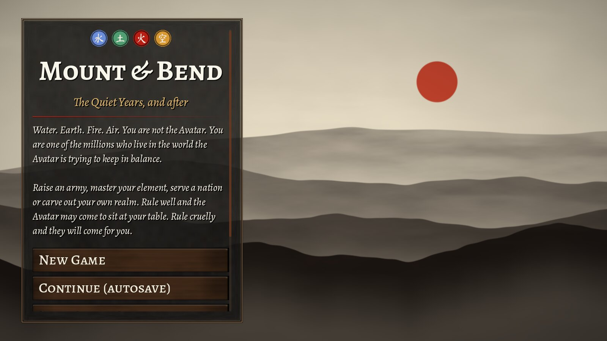
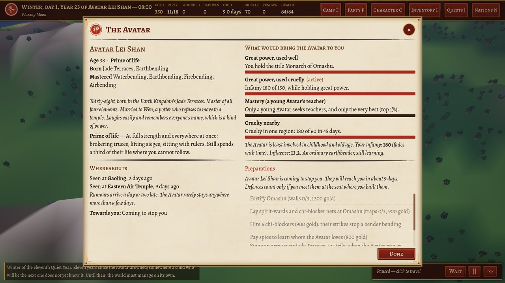
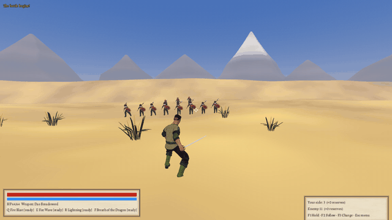
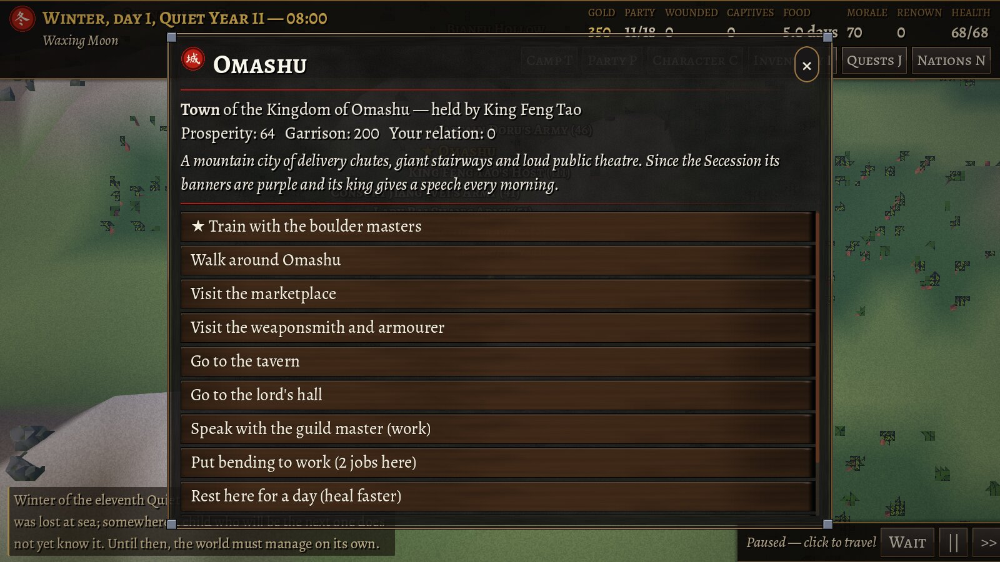
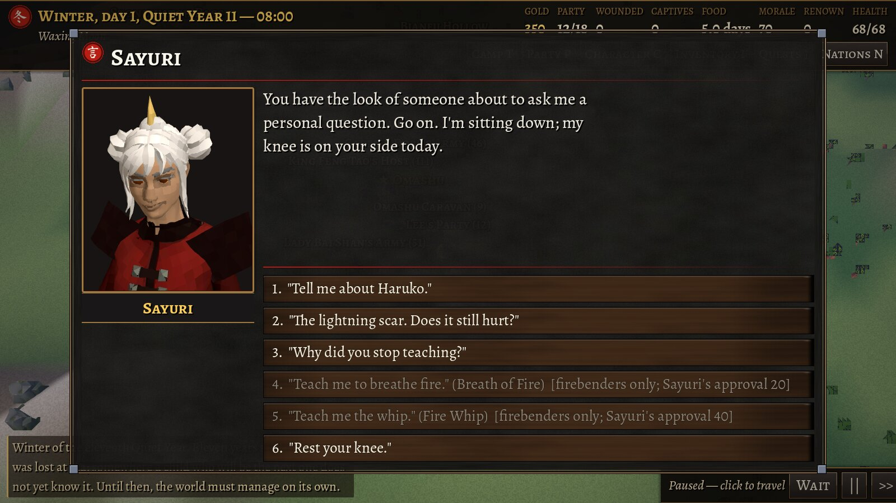

# Mount & Bend: The Quiet Years, and after

A Mount & Blade–style sandbox set in the world of *Avatar: The Last Airbender*, built in **Godot 4.3**. It uses the original series' world, peoples and rules of bending, set at an unnamed time long before Aang and before Yangchen, with original characters and stories. Lore is held to `docs/canon.md`.

**The core sandbox.** You raise an army, trade, take quests, serve or betray kingdoms, besiege cities, walk their streets, and fight real-time 3D battles with swords, bows and bending. That includes bending forms you compose yourself.

**You are never the Avatar.** You play a non-bender, or a bender of exactly one element. The Avatar is someone else: a person in the world who ages, spends much of their life out of reach, and comes to you only for one of four reasons, all visible in-game.



## Eras

| Era | Mode | The Avatar |
|---|---|---|
| **The Quiet Years** | Story campaign, *The Drowned Testament* | Eleven years ago the Avatar was lost at sea. The next one is a ten-year-old child, untold and unreachable. |
| **The Young Avatar** | Sandbox | Siku, 16, Southern Water Tribe, newly told and looking for masters |
| **The Avatar's Prime** | Sandbox | Lei Shan, 38, Earth Kingdom, master of all four elements and everywhere at once |
| **The Elder Avatar** | Sandbox | Akane, 84, Fire Nation, who keeps to her lake hamlet and is roused only by great evil |

In the Quiet Years the wars are these:
- the Fire Nation and the Earth Kingdom fight over the Strait Isles, islands both crowns have claimed for centuries;
- Omashu has seceded from Ba Sing Se;
- the Southern Water Tribe raids the Fire Navy;
- the Air Nomads shelter everyone.

The four nations otherwise live in harmony: no nation's army besieges another nation's land outside the disputed Isles. The Great Comet passes once a century and falls in about one game in three; there are no solar eclipses.

## Running the game

1. Install **Godot 4.3 or newer**, the standard build rather than the .NET one: <https://godotengine.org/download>.
2. Clone this repository, or download it as a ZIP and unzip it.
3. Start Godot, click **Import**, select `project.godot`, then **Import & Edit**. The first import takes a few minutes.
4. Press **F5** to play.

The project uses the *Compatibility* (OpenGL) renderer, so it runs on modest hardware. Export through **Project → Export** after installing the export templates.

## Controls

### World map
| Input | Action |
|---|---|
| Left click | Travel to the ground, a settlement or a party |
| Mouse wheel / right-drag / middle-drag or WASD | Zoom / rotate / pan (F re-centres) |
| M | Whole-world overview |
| Space, Ctrl or `>>` | Stop, fast travel |
| T / Esc | Camp: wait, talk with companions, bending around camp, the Avatar, save/load, settings |
| P, C, I, J, N | Party; Character (with **Bending Forms** and **Techniques**); Inventory; Quests; Nations (with **The Avatar**) |

A gold ★ on a settlement's label means a story beat is waiting there.

### Conversations
Choices are numbered: press **1–9** to choose, and **Enter** to continue.

### Walking a settlement
Choose **Walk around** in any friendly settlement's menu.

| Input | Action |
|---|---|
| WASD, Shift | Walk (Shift walks slowly) |
| Mouse, wheel | Look, zoom |
| E | Talk to the person in front of you |
| Tab, or leave through the gate | Back to the world map |

### Battle
| Input | Action |
|---|---|
| WASD, Shift, Space | Move, walk, jump |
| Left mouse | Attack. Direction follows your last mouse movement |
| Right mouse | Block (automatic by default) |
| 1 / 2 | Melee / ranged weapon |
| Q / E / R | Bending, or the techniques you set under Character → Techniques |
| F | Your bending form |
| F1 / F2 / F3 | Hold / follow / charge |
| Tab, Esc | Leave when the battle is decided; pause menu |

## What's in the game

### The Avatar
The Avatar is a persistent NPC who ages with the calendar. Life stage governs involvement: least in childhood and old age. The Avatar window (Nations → The Avatar, or Camp) shows what is known about them, their last sightings, their regard for you, and every rule that would bring them to you.



**Hard to find.**
- Long absences in remote places (travelling, secluded at temples, with teachers or family), visits of a few days, and rumours that arrive late.
- Where they are visiting, you can seek an audience; your chance is shown.

**Four reasons to come to you:**

| Reason | What happens |
|---|---|
| **Power used well:** a ruler's title (hold Caldera and you are Fire Lord), or great influence | They come to court to work with you |
| **Power used cruelly:** great power and high infamy | A warning first; then, if you defy it, a reckoning with allies |
| **Mastery:** you are in the top 1% of benders of the element a young Avatar needs next | They ask you to teach them; they travel with you for a season |
| **Local cruelty**, and they happen to be near | They block the road |

Infamy comes from raids, executions, scorched fields, betrayals and hostages.

**Countermeasures** against a hostile Avatar:
- fortify your seat;
- deny the ground (timber over courtyards, drained cisterns) and hang chi-blocker nets;
- hire chi-blockers;
- spy out whom they love and take them hostage;
- stage an army to raid their home when they move, so they turn back;
- or yield.

**The Avatar is never killed.** They bend every element they have mastered and enter the Avatar State once per battle. Beaten, they withdraw and return. If they beat you, they take apart what you built and give it back.

### The story: *The Drowned Testament* (Quiet Years)
On day 2 a wounded Air Nomad courier brings you a page of the lost Avatar's logbook. Six pages are scattered, each with two or more ways to get it. Along the way you meet the two men who let the Avatar die, over tea and over dinner. Then you decide what the truth is for:
- tell it to a Council of Nations;
- give it to one ruler;
- sell it to the man it condemns;
- burn it;
- or keep it for the next Avatar.

### Companions
Twelve companions, each with a personal quest, approval, campfire banter and partings. Eight have romances.

| Companion | Who they are |
|---|---|
| **Hana** | Autistic Lower Ring earthbender mapping the tunnels under Ba Sing Se |
| **Juro** | Fire Nation engineer who lost his fire after his designs burned a village |
| **Pemba** | Nonbinary Air Nomad who will not kill, looking for their sister |
| **Nima** | Northern healer who taught herself combat waterbending |
| **Ukiuk** | Southern harpooner with a debt from a raid |
| **Shen Mu** | Omashu courier carrying a letter that could stop a war |
| **Reika** | Fire Nation privateer starting to doubt her admiral |
| **Kesi** | Deaf sandbender exiled for refusing a raid |
| **Sayuri** *(fire expansion)* | Retired Agni Kai champion with chronic pain and a last student to set right |
| **Huan** *(water expansion)* | Swampbender who talks to trees; ace and aromantic |
| **Gao Ming** *(earth expansion)* | Jade miner and union organiser, raising a daughter |
| **Yangzom** *(air expansion)* | Nun charting the Thirty-Six Winds; keeps the vow |

### The four element expansions
Each can be switched off in Settings. Each adds:
- **Techniques:** a catalogue in three or four styles grounded in real martial arts (Northern Shaolin, Long Fist, Hung Gar, Southern Mantis, Yang- and Chen-style Tai Chi, Baguazhang). Learned from teachers in the world and set on Q, E or R.
- **Forms movements:** four new movements for the Forms designer.
- **Non-combat bending:** six or seven jobs. Any bending companion can do them for you.
- **People and stories:** new characters, a companion quest and a mastery trial that grants the element's master title.

| Expansion | Techniques | Bending at work | Mastery trial |
|---|---|---|---|
| **Embers of the First Flame** | Breath of Fire, Inner Flame, Fire Whip, Fire Daggers, Fire Jets, Ring of Fire | Temper blades, fire kilns, warm the camp, cook for the column, controlled burns, festival lanterns, and scorching fields (cruel) | Carry an ember of the Sun Warriors' Eternal Flame without using fire in anger; light a lamp with breath |
| **The Turning Tide** | Ice Lance, Ice Prison, Octopus Form, Tidal Surge, Vine Snare, Mist Veil, Chi-Path Healing | Healing houses, irrigation, fishing, clean wells, ice roads, ice carving | Walk the Moon's Road on your own ice |
| **Roots of the Mountain** | Seismic Sense (from the badgermoles), Fissure, Stone Fists, Stone Cuffs, Boulder Toss, Stone Armour | Mining, raising walls, terraces, roads, shelters, shoring tunnels | Three days listening to the mountain |
| **The Thirty-Six Winds** | Glider Strike, Updraft, Air Ball, Air Shield, Clearing Wind, Vortex, Wind Blade | Scouting by glider, filling sails, mills, smothering fires, meditation, bison flights | Four temples, four tests, and the arrows |

### Cultures and class
- **Standing** (Commoner, Citizen, Gentry, Noble) decides which gates open.
- **Ba Sing Se** has three rings with guarded gates, and the Censorate remembers thieves.
- **Fire Nation nobles** settle insults by **Agni Kai**.
- **The Northern Water Tribe** keeps the **Law of the Two Paths** until it changes.
- **The Southern council** can be swayed on war and peace.
- **Air Temples** cannot be attacked, heal you for free, and sell no meat.

### Attributes
Nine, after Dark Souls 3: Vigor, Attunement (bending and chi), Endurance, Vitality, Strength, Dexterity, Intelligence, Spirit (in place of Faith) and Luck, two points per level. Bending draws on Attunement and two attributes of its element: earth on Endurance and Vigor, water on Intelligence and Dexterity, air on Dexterity and Spirit, fire on Strength and Vitality.

### Bending
Fire is stronger by day, water by night and strongest under a full moon. The Great Comet, if it comes, makes fire burn far hotter; a lunar eclipse hides the full moon's strength. Only waterbenders heal with bending.

The **Bending Forms** designer composes forms (in the spirit of *Kengo*'s technique-building) from real martial-arts movements. Stances must chain and breath should alternate, and power, wind-up, chi and properties follow from what you chose.

To use it, open **Character → Bending Forms**, chain movements whose stances connect, name the form, and press **F** in battle.



### Look
- **3D:** realistic and muted, with a PS1 layer (Settings → Retro look; Heavy by default): vertices snap to a screen grid, and every surface (ground, rock, bark, foliage cards, people) shares one texel size. Ground and rock are computed from world position: hard-edged patches of ground, leaf litter under trees, and rock in zones of different stone with bedding, joints, staining, varnish and lichen. Mountains, canopies, pines and grass are painted cards. Character textures are repainted (`tools/paint_textures.py`).
- **Interface:** after PS2-era menus. Dark grained panels with a bronze border and steel corner caps, white serif titles over a red rule, menu entries on dark wood planks that light up as an amber bar, steel tablets for actions, and light text with a drop shadow. All text is 1.5× the old size.

Type is set in Alegreya and Alegreya SC, with a **Readable font** option (Atkinson Hyperlegible) and **Reduce motion**.




## Documents

| | |
|---|---|
| `docs/canon.md` | The lore authority: sources (the original series only; *Legend of Korra* excluded), when the game is set, the Avatar, bending, the sky, peoples, and every workaround the game uses to stay inside canon. Enforced in part by `tests/test_canon.tscn`. |
| `docs/setting.md` | The world at the start of play, cultures and class, the main story, lords, companions, sample banter |
| `docs/design.md` | Systems and their numbers: the Avatar, the element expansions, the Bending Forms designer, the interface |

## Art and licences

**Characters, outfits, hair, animations, nature, props and animals** are **CC0** assets by **Quaternius**:
- **Repainting:** recoloured into culture palettes and drawn with a cel shader and ink outlines.
- **Faces:** expressions are morph targets generated in code.
- **Architecture:** generated by `scripts/town/arch.gd`.
- **Sound and music:** synthesised at runtime.

**Fonts** are under the SIL Open Font License; see `assets/LICENSES.md`.

## Project layout

```
project.godot           autoloads: Data, GS, Sfx, Music
assets/                 CC0 models, textures, animations; OFL fonts (see assets/LICENSES.md)
shaders/                cel, painted architecture, ink outline, UI vignette, ink-wash title
scenes/                 main_menu, world_map, battle, town
scripts/autoload/       game_data (content), game_state (state, calendar, standing, duels, save/load)
scripts/core/           world simulation, economy, quests, terrain, the Avatar, bending work
scripts/story/          story engine, main story, companion quests, camp talk, endings, the Avatar's scenes
scripts/dlc/            the four element expansions (registry and stories)
scripts/actors/         character builder, actor, accessories, looks, mounts, bending stances
scripts/town/           architecture kit, settlement layouts, townspeople, walkable town
scripts/battle/         battle, units, bending, forms, techniques, projectiles, set dressing
scripts/world/          world map and its builders
scripts/ui/             skin (materials and fonts), theme, windows
tools/                  how the CC0 packs were prepared
tests/                  headless tests (below)
```

## Tests

```
godot --headless --path . res://tests/check_scripts.tscn    # parse every script
godot --headless --path . res://tests/test_canon.tscn       # forbidden names, map, sieges across nations, the sky, the Avatar's cycle and whereabouts
godot --headless --path . res://tests/test_story.tscn       # validate all dialogue graphs; play every ending and companion quest
godot --headless --path . res://tests/test_avatar.tscn      # eras, life stages, the four motives, countermeasures, judgement, teaching
godot --headless --path . res://tests/test_dlc.tscn         # every technique teachable, every trial and quest, all 25 bending jobs, expansion switches
godot --headless --path . res://tests/test_personas.tscn    # persona bots across all four eras (add "-- sandbox" for sandbox eras only)
godot --headless --path . res://tests/test_town.tscn        # build ten walkable settlements, open every interaction
godot --headless --path . res://tests/test_ui.tscn          # open every window, press its buttons
godot --headless --path . res://tests/test_flows.tscn       # siege defence, captivity, save/load
godot --headless --path . res://tests/test_battle.tscn -- field   # also: siege, arena, duel, big, bend <element>,
                                                                   # avatar young|prime|elder, tech <element>
```

## Notes

This is a non-commercial fan project. *Avatar: The Last Airbender* belongs to its creators, Nickelodeon and Paramount; the game cannot be sold without a licence. All characters and stories here are original to this project.
